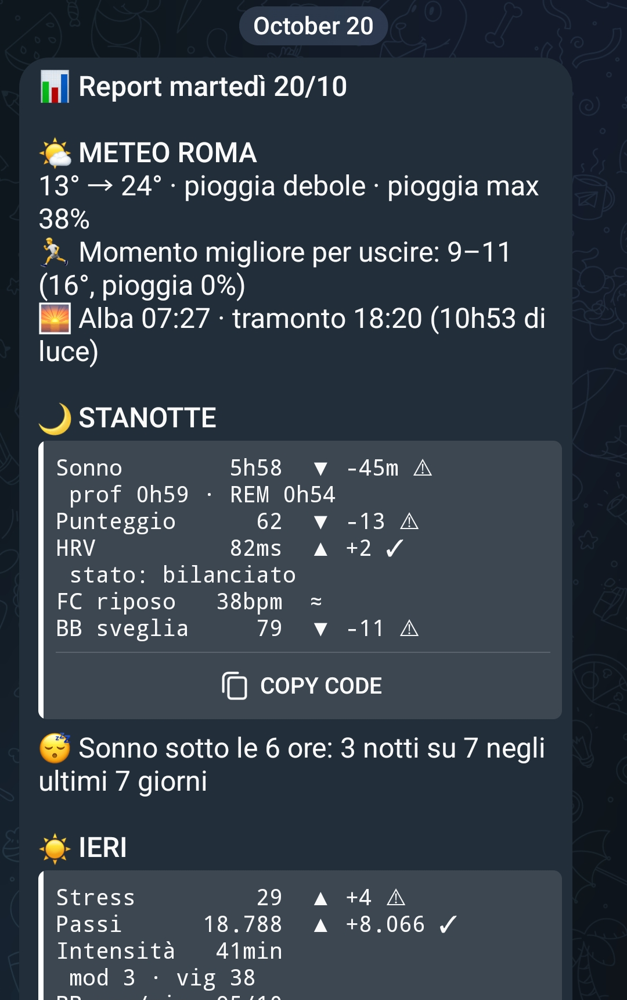

# Health & News Agent

A personal multi-step agent (Python, LangGraph) that runs every morning on my own laptop and sends me a **health briefing** built from my Garmin data and a **personalized news digest**, both delivered on Telegram. The language model runs **locally** (Ollama), so no health data leaves my machine.

> Personal project. It gives lifestyle suggestions only, never medical advice.

<p align="center">
  
  &nbsp;&nbsp;
  
</p>

## What it does

- **Morning health report.** Reads sleep, HRV, resting heart rate, stress, body battery and steps from Garmin, compares them with my own 7-day baseline (z-scores, trends, an absolute sleep floor) and produces a short report.
- **Daily news digest.** Pulls about 18 Italian and English RSS feeds, groups duplicate stories with `bge-m3` embeddings (average-linkage clustering), selects the most relevant ones for my interests and summarizes them, citing sources for every sentence.
- **Weekly report.** Every Sunday: charts of the current week against the previous one, and a running-efficiency estimate (speed vs. heart rate) that stays silent when there is not enough data.
- **Weather** from Open-Meteo, with retries.

## Design principles

1. **Deterministic analysis, LLM only rephrases.** Every number and every advice is computed by rules first; the local LLM only rewrites the text. It never decides a fact.
2. **Every LLM output is validated** (format, numbers, cited sources, grounding checks on sensitive terms and on the direction of claims such as rises/falls) and has a rule-based fallback if validation or Ollama fails.
3. **Better no number than a wrong number.** Below a minimum amount of data the bot shows facts, not invented trends.
4. **Idempotent.** A run state file prevents duplicate messages; the scheduled task can fire several times a day safely.

## Architecture

LangGraph pipeline in `health_agent/graph.py`:

```
ingestion -> normalization -> analysis -> running -> extras
          -> recommendation -> notifier -> news -> weekly
```

A node that fails does not block the others: the error is added to the shared state and reported at the end.

| Module | Role |
|---|---|
| `nodes/ingestion.py`, `nodes/normalization.py` | Garmin data, night vs. day metrics aligned to the right date |
| `nodes/analysis.py` | 7-day baseline, z-scores, linear trends, sleep threshold |
| `nodes/recommendation.py`, `llm.py` | Rule-based advice, rephrased by the local LLM |
| `news.py`, `embeddings.py`, `archive.py` | RSS, embeddings, clustering, SQLite archive |
| `grounding.py` | Deterministic checks on LLM sentences |
| `running.py`, `weekly.py` | Run analysis and weekly charts (matplotlib) |
| `nodes/notifier.py`, `telegram_logs.py` | Telegram delivery and logs |

## Stack

Python, LangGraph, Ollama (local LLM), sentence embeddings (`bge-m3`), pandas, matplotlib, SQLite, Telegram Bot API, pytest, Windows Task Scheduler.

## Setup

```bash
python -m venv .venv
.venv\Scripts\activate          # Windows
pip install -r requirements.txt
copy .env.example .env          # then fill in your own credentials
```

`.env` holds the Garmin and Telegram credentials and is **never committed** (see `.gitignore`). Local health data lives in `data/`, also ignored.

```bash
python main.py --dry-run        # build the report without sending it
python main.py --dry-run --weekly
python main.py --force          # real send
python -m pytest tests -q       # tests
```

The daily run is scheduled with Windows Task Scheduler.

## Status and next steps

Working and used daily. Planned: run Garmin and weather in the cloud (GitHub Actions) so the report arrives even when the laptop is off, and integrate the claim verifier from my [`rag_verifier`](#) project to check news sentences.

<!-- TODO: replace the link above once rag_verifier is public -->
